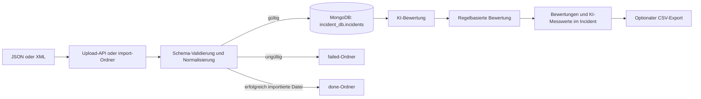

# Rohmaterial für Dokumentation und Präsentation

**Projekt:** Incident-Import und Schweregradbewertung mit Regeln und KI  
**Stand:** 14. November 2026  
**Zweck:** Inhalt, Demoablauf und auszufüllende Vergleichstabelle für eine Präsentation von 10–15 Minuten. Dieses Dokument trennt vorhandene Implementierung von noch ausstehenden Versuchsergebnissen.

## 1. Leitfrage und Kurzantwort

**Leitfrage:** Wie unterscheiden sich regelbasierte und KI-gestützte Schweregradbewertungen von IT-Incidents bei Qualität, Zeitaufwand, Nachvollziehbarkeit und Zuverlässigkeit?

Das Projekt importiert JSON und XML, validiert beide Formate, speichert normalisierte Incidents in MongoDB und vergibt zwei Bewertungen von 1 bis 10. Der Code für beide Varianten ist vorhanden. **Eine belastbare Antwort, welche Variante im gewählten Datensatz besser bewertet, steht noch aus:** Im Repository fehlen fachliche Sollwerte und eine abgeschlossene Messreihe mit mindestens zehn Incidents. Die fachliche Schlussfolgerung muss nach diesem Versuch ergänzt werden.

Grundlagen: [Aufgabe.md](Aufgabe.md), [README.md](README.md), [datenmodell.md](datenmodell.md).

## 2. Was umgesetzt ist

| Anforderung | Umsetzung und Beleg | Stand |
| --- | --- | --- |
| Zwei Austauschformate | JSON und XML in [loaders.py](loaders.py); Regeln in [JSON-Schema](schemas/incidents.schema.json) und [XSD](schemas/incidents.xsd) | Implementiert |
| Gemeinsames Format | Beide Loader liefern Python-Dictionaries mit denselben Incident-Feldern | Implementiert |
| NoSQL-Speicherung | MongoDB `incident_db.incidents`, eindeutiger Index auf `incident_id`, Upsert in [main.py](main.py) | Implementiert |
| Klassische Analyse | Gewichtete Regeln und Schlüsselwörter in [manual.py](manual.py) | Implementiert |
| KI-Analyse | Strukturiertes JSON aus `/v1/chat/completions` in [llm.py](llm.py) | Implementiert |
| Vergleich | [compare.py](compare.py) exportiert vorhandene Regel-/KI-Werte und Begründungen als `comparison.csv` | Export implementiert; vollständige Auswertung offen |
| Mindestens zehn bewertete Testfälle | Zehn geeignete Fälle sind unten ausgewählt | Sollwerte, KI-Ergebnisse und Vergleich noch offen |

Die Beispieldateien in `samples/` sind ein Pool, kein bereits ausgewerteter Datensatz. Für den Abgabeversuch eine feste Auswahl von ungefähr 20–30 Incidents dokumentieren; nicht alle Batch-Dateien ungeprüft zusammen importieren. Das illustrative Beispieldokument in [datenmodell.md](datenmodell.md) enthält **keine gemessenen** Resultate.

## 3. Datenfluss und Demo-Erzählung



Sprechtext: Die API legt hochgeladene Rohdaten zunächst im `import/`-Ordner ab. [main.py](main.py) prüft dort alle zwei Sekunden auf Dateien. [loaders.py](loaders.py) validiert die Dateistruktur und jeden Incident einzeln. Gültige Einträge werden per `incident_id` in MongoDB eingefügt oder aktualisiert; abgewiesene Einträge landen in `failed/`, erfolgreich verarbeitete Dateien in `done/`. Danach bewertet der Prozess erst per KI, dann regelbasiert. Ein erfolgreicher HTTP-Upload bestätigt nur das Speichern der Datei, **nicht** bereits die abgeschlossene Bewertung.

Wichtig für die Demo: Bei einem erneuten Import derselben `incident_id` werden die Incident-Felder aktualisiert, abgeschlossene Bewertungen aber nicht automatisch neu berechnet. Für einen sauberen Vergleich daher einen isolierten Testbestand und eindeutige IDs verwenden.

## 4. Austauschformate und Validierung

Pflichtfelder: `incident_id`, `zeitpunkt`, `system_service`, `fehlermeldung`, `schweregrad`, `status`, `kategorie`. `bekannte_loesung` ist optional. `zeitpunkt` muss eine gültige Zeitangabe mit Zeitzone sein. Für Schweregrad und Status sind nur die Werte der Schemata erlaubt. Die JSON-Struktur verlangt ein `incidents`-Array; XML verlangt `<incidents>` mit `<incident>`-Elementen.

Für eine Validierungsdemo eignen sich die Assessment-Dateien: In [JSON](samples/incidents_for_assessment.json) fehlt bei `INC-2026-T006` der `zeitpunkt`, in [XML](samples/incidents_for_assessment.xml) fehlt bei `INC-2026-T012` die `fehlermeldung`. Diese beiden Fälle gehören **nicht** zu den zehn gültigen Vergleichsfällen. Beim Import lässt sich zeigen, dass gültige Einträge derselben Datei erhalten bleiben und ungültige getrennt abgelegt werden. Vor der Präsentation den Ablauf einmal mit genau den vorgesehenen Dateien prüfen.

## 5. NoSQL-Datenmodell

Ein MongoDB-Dokument entspricht einem Incident. Die importierten Störungsfelder, beide Bewertungen und die KI-Messwerte liegen gemeinsam darin. `impact_rating_ai` und `rating_manual` enthalten jeweils `impact_rating` und `impact_reason`; `metrics_ai` enthält Modellname, Dauer und Tokenzahlen. `rated_ai` und `rated_manual` markieren abgeschlossene Bewertungen. `incident_id` hat einen eindeutigen Index. Details und Beispielabfragen stehen in [datenmodell.md](datenmodell.md).

**Demonstrationsabfrage:** Einen importierten Incident über seine fachliche ID suchen und die beiden Unterdokumente zeigen. In PowerShell mit dem Python der Projektumgebung:

```powershell
.\.venv\Scripts\python.exe -c "from pymongo import MongoClient; print(MongoClient()['incident_db']['incidents'].find_one({'incident_id': 'INC-2026-T001'}, {'_id': 0}))"
```

Die gleiche Abfrage lässt sich unter macOS/Linux mit `.venv/bin/python` ausführen. Den tatsächlichen Datenbankinhalt erst nach einem erfolgreichen Import zeigen.

## 6. Die zwei Bewertungswege

**Regeln:** [manual.py](manual.py) wandelt den importierten `schweregrad` in einen numerischen Hinweis um, ordnet bekannte Kategorien Punktwerte zu und sucht Schlüsselwörter in den übrigen Incident-Feldern. Das stärkste gefundene Schlüsselwort zählt. Die Gewichte sind 15 % Schweregrad-Hinweis, 60 % Schlüsselwörter, 25 % Kategorie. Nicht verfügbare Komponenten entfallen; die restlichen Gewichte werden normalisiert. Ohne verwertbare Hinweise ist der Wert 5. Der Grundtext nennt verwendete Teilwerte und Treffer. Das Verfahren ist bei gleichen Eingaben und gleichem Code reproduzierbar.

**KI:** [llm.py](llm.py) schickt die Incident-Daten an das konfigurierte Sprachmodell. Der Prompt verlangt eine Zahl von 1 bis 10 und eine kurze Begründung als JSON-Schema. Er nennt betroffene Nutzer/Systeme, Geschäftsfolgen, Kritikalität, Workaround sowie Sicherheits- und Datenrisiken als Kriterien. Das importierte Feld `schweregrad` soll nur ein schwacher Hinweis sein; diese Anweisung garantiert keine feste Modellgewichtung. Der Code misst die HTTP-Anfragedauer mit `time.perf_counter()` und speichert Dauer und Tokenzahlen in `metrics_ai`. Die KI erzeugt Bewertungen und Empfehlungen, führt aber keine Systembefehle aus.

**Anschauliche Fälle für die Folien:** `INC-2026-T001` beschreibt einen kurzen Druckerausfall an einem Einzelarbeitsplatz; `INC-2026-T005` beschreibt gestoppte Fertigungslinien ohne freigegebenen manuellen Betrieb. Damit lässt sich erklären, weshalb konkrete Auswirkungen wichtiger sein können als ein blosses Stichwort. Ob die KI die beiden Fälle tatsächlich besser als die Regeln bewertet, muss die Vergleichsmessung zeigen.

## 7. Vergleich: vorab festzulegende Methode

1. **Testmenge fixieren:** Die zehn gültigen Assessment-Fälle in der Tabelle unten verwenden, fünf aus JSON und fünf aus XML. Die zwei ungültigen Fälle separat für die Validierungsdemo behandeln.
2. **Sollwerte vor dem Lauf festlegen:** Mindestens zwei Teammitglieder vergeben für jeden gültigen Incident unabhängig einen fachlich begründeten Wert von 1 bis 10. Abweichungen gemeinsam klären und den finalen Sollwert samt Begründung festhalten, bevor Regel- und KI-Ausgaben angeschaut werden.
3. **Qualität messen:** Pro Verfahren den absoluten Fehler `|Bewertung − Sollwert|` berechnen; zusätzlich exakte Treffer und Treffer mit höchstens einem Punkt Abweichung zählen. Kritische Unterbewertungen gesondert besprechen.
4. **Zeit fair messen:** `metrics_ai.duration_seconds` ist die Dauer einer KI-HTTP-Anfrage. Die Regel-Laufzeit wird derzeit **nicht** in MongoDB gespeichert; sie muss separat mit `time.perf_counter()` um `manual.rate_incident(...)` auf derselben Maschine gemessen werden. Diese beiden Messgrenzen im Vortrag benennen. Für belastbare Zahlen mehrere Wiederholungen und Median angeben.
5. **Nachvollziehbarkeit und Zuverlässigkeit prüfen:** Begründungen anhand konkreter Incident-Angaben und fehlender Annahmen beurteilen. Regeln bei gleicher Eingabe erneut ausführen; für KI-Wiederholungen einen isolierten Testbestand nutzen, weil `rated_ai=True` automatische Neubewertung verhindert. Fehlversuche und ungültige Antworten zählen.

[compare.py](compare.py) liefert nur `incident_id`, Regelwert, KI-Wert, ihren Unterschied und beide Begründungen. Es enthält weder fachliche Sollwerte noch Regel-Laufzeiten. Die nachstehende Tabelle muss deshalb mit den zusätzlichen Messungen ergänzt werden.

### Zehn ausgewählte Vergleichsfälle

Die Spalte „Regel“ wurde am 14.11.2026 **direkt aus `manual.rate_incident`** mit den Assessment-Daten berechnet. Das ist eine reproduzierbare Vorberechnung, aber noch keine abgeschlossene Import- und KI-Vergleichsstudie. „offen“ bedeutet: noch nicht fachlich festgelegt oder gemessen.

| Incident | Format | Betroffener Dienst (kurz) | Importierter Schweregrad | Regel | Soll | KI | KI-Zeit (s) | Urteil |
| --- | --- | --- | --- | ---: | ---: | ---: | ---: | --- |
| T001 | JSON | Bürodrucker | niedrig | 3 | offen | offen | offen | offen |
| T002 | JSON | Outlook-Kalenderfreigabe | mittel | 5 | offen | offen | offen | offen |
| T003 | JSON | Service Portal | mittel | 5 | offen | offen | offen | offen |
| T004 | JSON | SAP Versand-Schnittstelle | mittel | 5 | offen | offen | offen | offen |
| T005 | JSON | MES Produktionsrückverfolgung | kritisch | 8 | offen | offen | offen | offen |
| T007 | XML | Raumbuchungspanel | niedrig | 3 | offen | offen | offen | offen |
| T008 | XML | Lager-Handscanner | mittel | 6 | offen | offen | offen | offen |
| T009 | XML | Power BI Dashboard | hoch | 8 | offen | offen | offen | offen |
| T010 | XML | Unternehmens-VPN | hoch | 7 | offen | offen | offen | offen |
| T011 | XML | Kundenportal / API | hoch | 8 | offen | offen | offen | offen |

Die Tabellenkürzel entsprechen den vollständigen IDs `INC-2026-T001` bis `INC-2026-T011` in den Assessment-Dateien. Vor der Abgabe die Tabelle um Regel-Laufzeit, absolute Fehler und Begründungsbewertung ergänzen; dann Kennzahlen und die Antwort auf die Leitfrage berechnen.

## 8. Risiken und mögliche Kontrollen

| Beobachtbares Risiko aus dem Code oder Ablauf | Mögliche Kontrolle |
| --- | --- |
| Ungültige Eingaben oder fehlende Pflichtfelder | JSON-Schema/XSD, `failed/` prüfen, abgewiesene Datensätze korrigieren |
| KI kann trotz Prompt falsche oder unbelegte Werte liefern | Strukturierte Antwort prüfen, Begründung und kritische Fälle menschlich prüfen |
| Modell- oder Promptänderung kann Ergebnisse verändern | Modellname und Testversion protokollieren, Vergleichslauf wiederholen |
| `rated_ai`/`rated_manual` verhindern automatische Neubewertung aktualisierter Incidents | Änderungen und Bewertungsversionen nachvollziehen; für neue Versuche isolierte Daten verwenden |
| Regelwörter können Kontext übersehen; die Suche berücksichtigt auch `bekannte_loesung` | Fehlklassifikationen an Testfällen auswerten, Wortlisten und berücksichtigte Felder gezielt pflegen |
| KI-Server, Container oder Netzwerk können ausfallen | Bereitschaftsprüfungen und Zeitlimits beim Start; Fehler im Betrieb überwachen |
| Incident-Texte können sensible Informationen enthalten | Nur freigegebene Daten an den KI-Endpunkt senden; Zugriff und Aufbewahrung regeln |

Diese Punkte sind **Risiken bzw. Kontrollen**, keine behaupteten Beobachtungen aus zehn gemessenen Fällen. Beobachtete Fehler aus dem Vergleich nachtragen.

## 9. Schlussfolgerung: Textgerüst für ½–1 Seite

Die Anwendung zeigt, dass sich JSON- und XML-Incidents in einem gemeinsamen MongoDB-Modell speichern und mit zwei Verfahren bewerten lassen. Die regelbasierte Methode nutzt festgelegte Gewichte und Schlüsselwörter; ihre Entscheidungen sind anhand der Teilwerte gut nachzuverfolgen. Die KI nutzt den gesamten Incident-Text und liefert eine sprachliche Begründung. **Welche Methode in den zehn ausgewählten Fällen genauer ist, lässt sich ohne Sollwerte und vollständige KI-Messung nicht seriös behaupten.**

Nach der Messung diesen Abschnitt mit konkreten Zahlen und Incident-IDs vervollständigen:

- **Wo war die KI besser?** `[Fälle, Sollwert, beide Werte, Begründung einsetzen]`
- **Wo war die klassische Lösung besser?** `[Fälle, Sollwert, beide Werte, Begründung einsetzen]`
- **Welche Fehler und Risiken wurden beobachtet?** `[Validierungsfehler, falsche Bewertungen, Ausfälle, Wiederholungsabweichungen einsetzen]`
- **Produktiver Einsatz?** `[Entscheidung auf Basis der gemessenen Qualität und Betriebsanforderungen einsetzen]`
- **Welche Kontrollen wären nötig?** `[z. B. menschliche Freigabe kritischer Fälle, Monitoring, Versionierung, Datenschutz, erneute Tests nach Änderungen konkretisieren]`

Als abschliessende Aussage für die Folie eine klare, durch die Zahlen gedeckte Antwort auf die Leitfrage formulieren. Ohne die Messung nur die technische Funktionsfähigkeit präsentieren, nicht eine Qualitätsüberlegenheit behaupten.

## 10. Ablauf für eine 12-Minuten-Präsentation

| Zeit | Inhalt und Material |
| --- | --- |
| 0:00–1:00 | Leitfrage, Aufgabe und ausgewählte Schweregradanalyse |
| 1:00–2:30 | JSON/XML, Pflichtfelder und zwei ungültige Assessment-Fälle |
| 2:30–4:00 | Datenflussdiagramm und ein MongoDB-Incident-Dokument |
| 4:00–6:00 | Regelbewertung erklären; KI-Prompt und strukturiertes Ergebnis zeigen |
| 6:00–8:30 | Live-Demo: Docker/Podman bewusst auswählen, Upload, `done/`/`failed/`, Datenbankabfrage |
| 8:30–10:30 | Zehn-Fälle-Tabelle, Kennzahlen, je ein aussagekräftiger Vor- und Nachteil |
| 10:30–12:00 | Risiken, nötige Kontrollen und klare Antwort auf die Leitfrage |

**Demo-Vorbereitung:** Python-Umgebung, Docker oder Podman, Modell und MongoDB-Daten vorab prüfen. Vor dem Vortrag festhalten, ob das Projektvolume in Docker oder Podman liegt. Beim interaktiven Start mit [start.py](start.py) dieses System beim Prompt ausdrücklich auswählen; ohne interaktives Terminal `--runtime docker` beziehungsweise `--runtime podman` angeben. Die Eingabe ist bewusst nicht vorbelegt, damit nicht versehentlich ein neues Volume im anderen System entsteht. Das Skript wartet danach auf die Bereitschaft der Dienste. Für die Validierungsdemo die Assessment-Dateien verwenden. Die API akzeptiert den Dateiinhalt direkt als `application/json` oder `application/xml` (siehe [README.md](README.md)). Vor dem Vortrag einen Probelauf durchführen und die zehn Vergleichsergebnisse sichern, damit die Präsentation nicht von einem ersten Modelldownload abhängt.

**Noch zu erledigen:** fachliche Sollwerte festlegen; zehn gültige Fälle vollständig importieren und KI-bewerten; Regel-Laufzeiten separat messen; Vergleichstabelle und Schlussfolgerung mit echten Ergebnissen ausfüllen; Folien und Demo auf 10–15 Minuten proben.
